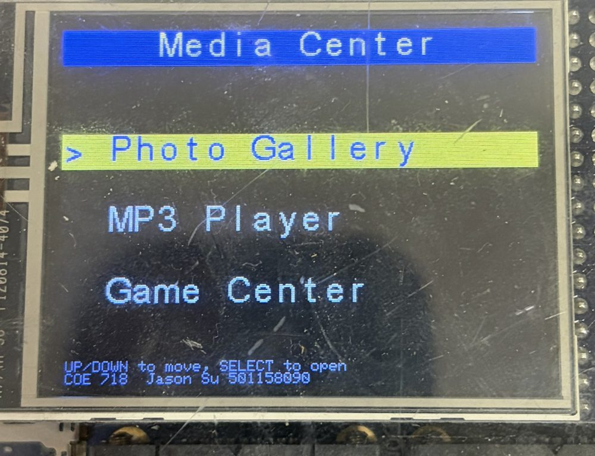
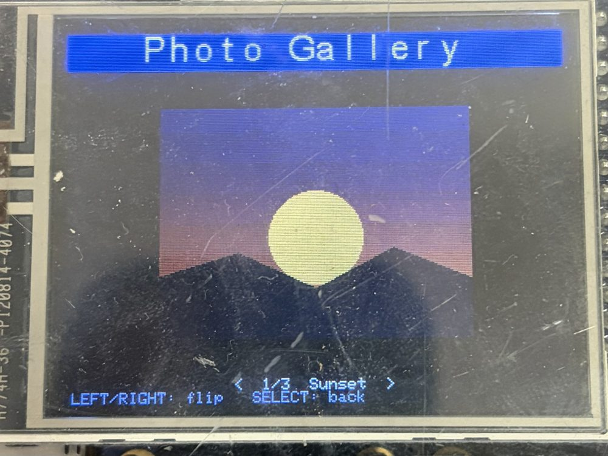
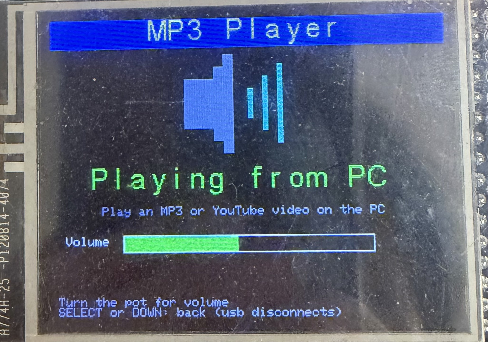
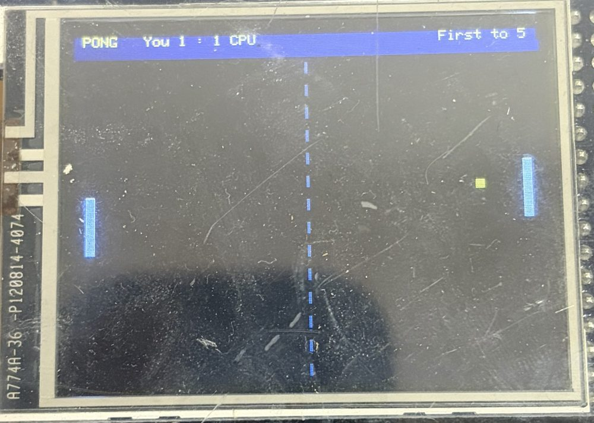
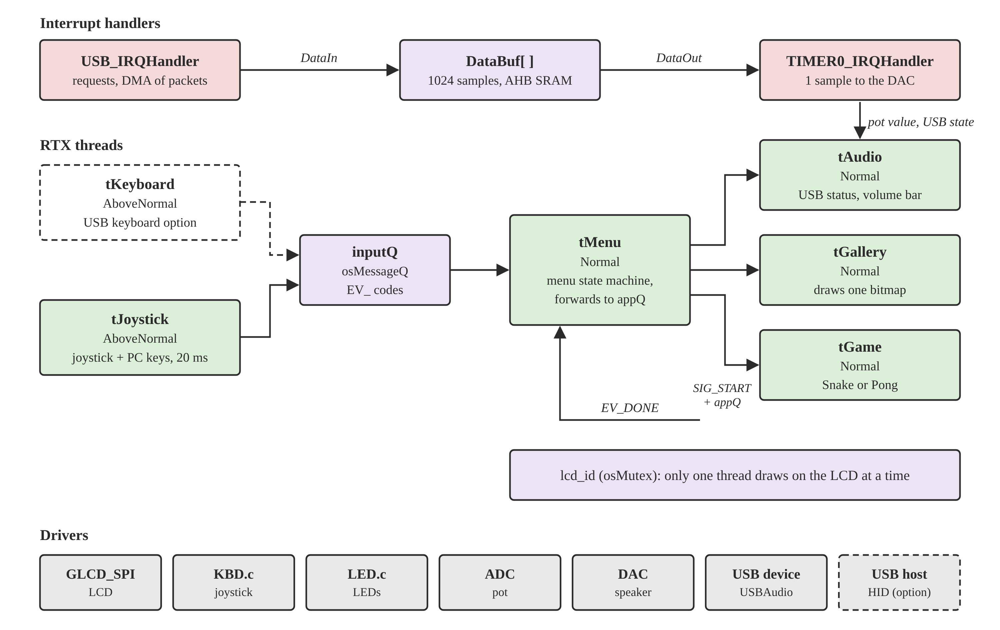

# Media Center on the MCB1700 (COE 718)

Final project for COE 718 (Embedded Systems Design) at Toronto Metropolitan University. It turns the Keil MCB1700 board (NXP LPC1768, ARM Cortex-M3) into a small media center with a photo gallery, a music player and two games, all running as threads on Keil RTX.

The full write-up is in the [final report (PDF)](docs/COE718_Final_Project_Report.pdf).

## Features

- **Main menu** on the 320 x 240 LCD, moved through with the joystick.
- **Photo gallery**: a carousel of pictures stored in flash as RGB565 arrays. Joystick left and right flips between them.
- **MP3 player**: the board connects to the PC as a USB speaker (based on Keil's USBAudio example), so anything the PC plays, like an MP3 or a YouTube video, comes out of the board speaker. Audio arrives over USB by DMA and a Timer0 interrupt sends it to the DAC at 32 kHz. The potentiometer sets the volume, the screen shows the connection state, and the board disconnects from the PC when you leave the player. A backup mode that plays a song stored in flash is also in the project (`USE_AUDIO 2`).
- **Game Center** with two games:
  - **Snake**, with score, pause and game over screens.
  - **Pong** against a computer paddle, first to 5 points.
- **PC keyboard input**: while the board runs under the ULINK2 debugger, keys typed in uVision's Debug (printf) Viewer control the menus and games.

| Gallery | MP3 player | Snake | Pong |
| --- | --- | --- | --- |
|  |  |  |  |

## How it works

The program is split into six RTX threads. The input threads put events on one message queue (`inputQ`). `tMenu` is the only thread that reads it, and it either handles the event itself or forwards it to whichever app is open through a second queue (`appQ`). A mutex keeps the threads from drawing on the LCD at the same time.

| Thread | Priority | Job |
| --- | --- | --- |
| tJoystick | AboveNormal | polls the joystick and the PC keyboard every 20 ms |
| tKeyboard | AboveNormal | optional USB keyboard on the board (`USE_KEYBOARD 1`) |
| tMenu | Normal | main menu and game menu, routes input |
| tGallery | Normal | photo gallery |
| tAudio | Normal | MP3 player screen, USB status and volume bar |
| tGame | Normal | Snake or Pong |

More diagrams are in [`docs/figures`](docs/figures): the hardware layout, the menu state machine and the audio path.

## Building

You need Keil uVision 5 with the LPC1700_DFP 2.6.0 and CMSIS 5.7.0 packs (Keil RTX 4.82), plus a ULINK debugger for flashing.

1. Open `MediaCenter/MediaCenter.uvprojx`.
2. Build (F7), flash (F8) and press RESET on the board.

Build switches are at the top of `MediaCenter/media.h`:

| Switch | Default | Meaning |
| --- | --- | --- |
| `USE_AUDIO` | 1 | 1 = USB speaker, 2 = song in flash (backup), 0 = screen only |
| `USE_KEYBOARD` | 2 | 2 = PC keyboard through the debugger, 1 = USB keyboard on the board, 0 = joystick only |
| `POT_INVERT` | 1 | flips the pot so counter clockwise is louder |

The full setup notes (target memory settings, RTX config values, USB audio scatter file, adding your own pictures and songs) are in [`MediaCenter/README.md`](MediaCenter/README.md).

## Controls

| Screen | Joystick |
| --- | --- |
| Menus | UP / DOWN move, SELECT opens |
| Gallery | LEFT / RIGHT flip, SELECT back |
| MP3 player | play from the PC, pot = volume, SELECT or DOWN back |
| Snake | four directions |
| Pong | UP / DOWN (hold) |
| In a game | SELECT pauses, then DOWN quits |

With the PC keyboard: W A S D or the arrow keys move, Enter, Space or P select or pause, Q goes back.

## Tools

- `tools/img2c.py` converts a picture into a flipped RGB565 C header for the gallery.
- `tools/wav2c.py` converts a WAV file into `song.h` for the backup flash song mode (8 bit, mono, 8 kHz).

## Notes

- For the MP3 player, plug the board's USB device connector into the PC and pick the board as the sound output in Windows. No driver is needed.
- For the PC keyboard, select the ULINK2/ME Cortex Debugger in Options for Target > Debug (not the simulator), with the SW port and trace enabled at 100 MHz. Start a debug session, run, and type in View > Serial Windows > Debug (printf) Viewer.
- The USB keyboard on the board is an optional input. It needs the D+/D- jumpers set to Host, so the default build uses the PC keyboard instead.
- The LPC1768 has one USB controller, so host mode (USB keyboard) and device mode (USB speaker) cannot run at the same time. The code only starts host mode inside the Game Center and shuts it down on exit.

## Credits

The LCD, LED and joystick drivers and the USB audio files come from the Keil MCB1700 examples used in the COE 718 labs. Everything else was written by Jason Su.
