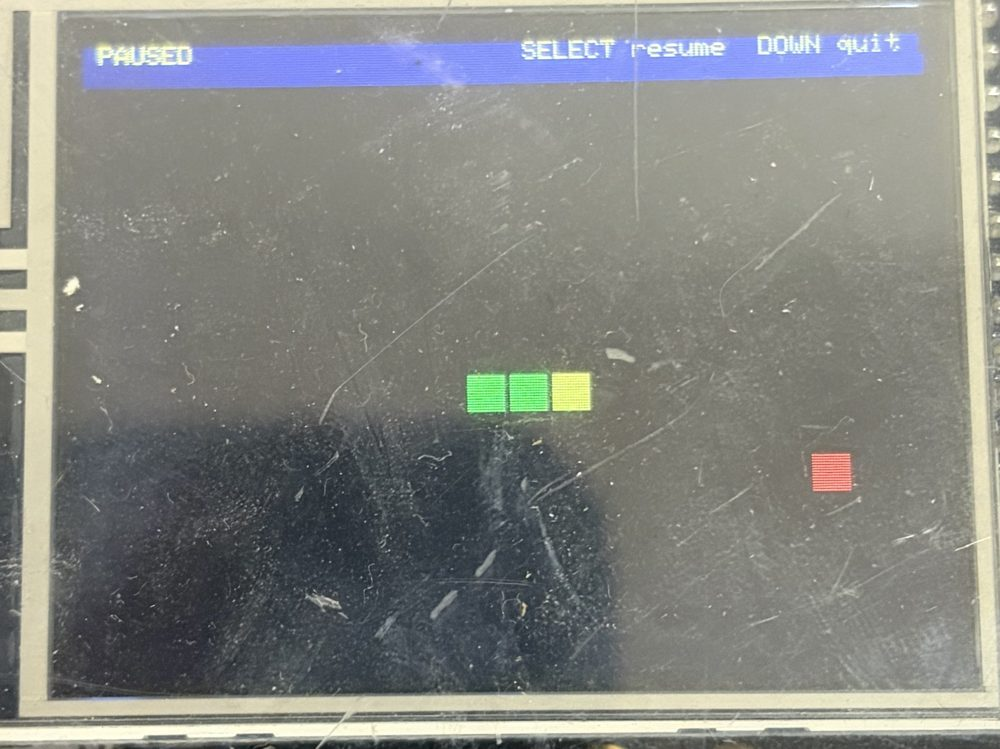

# Media Center on the MCB1700 (COE 718)

Final project for COE 718 (Embedded Systems Design) at Toronto Metropolitan University. It turns the Keil MCB1700 board (NXP LPC1768, ARM Cortex-M3) into a small media center with a photo gallery, a music player and two games, all running as threads on Keil RTX.

## Features

- **Main menu** on the 320 x 240 LCD, moved through with the joystick.
- **Photo gallery**: a carousel of pictures stored in flash as RGB565 arrays. Joystick left and right flips between them.
- **MP3 player**: splash screen, play/pause, restart, a progress bar and a volume bar. The potentiometer sets the volume. The default build plays a song stored in flash through the DAC and the board speaker, sampled at 8 kHz by a Timer0 interrupt. A USB speaker mode based on Keil's USBAudio example is also in the project (`USE_AUDIO 1`).
- **Game Center** with two games:
  - **Snake**, with score, pause and game over screens.
  - **Pong** against a computer paddle, first to 5 points.

| Gallery | MP3 player | Snake | Pong |
| --- | --- | --- | --- |
|  |  |  |  |

## How it works

The program is split into six RTX threads. The two input threads put events on one message queue (`inputQ`). `tMenu` is the only thread that reads it, and it either handles the event itself or forwards it to whichever app is open through a second queue (`appQ`). A mutex keeps the threads from drawing on the LCD at the same time.

| Thread | Priority | Job |
| --- | --- | --- |
| tJoystick | AboveNormal | polls the joystick every 20 ms |
| tKeyboard | AboveNormal | USB host mode for a keyboard (not used in the default build) |
| tMenu | Normal | main menu and game menu, routes input |
| tGallery | Normal | photo gallery |
| tAudio | Normal | music player screen |
| tGame | Normal | Snake or Pong |

More diagrams are in [`docs/figures`](docs/figures): the hardware layout, the menu state machine and the audio path.

## Building

You need Keil uVision 5 with the LPC1700_DFP 2.6.0 and CMSIS 5.7.0 packs (Keil RTX 4.82), plus a ULINK debugger for flashing.

1. Open `MediaCenter/MediaCenter.uvprojx`.
2. Build (F7), flash (F8) and press RESET on the board.

Build switches are at the top of `MediaCenter/media.h`:

| Switch | Default | Meaning |
| --- | --- | --- |
| `USE_AUDIO` | 2 | 2 = song in flash, 1 = USB speaker, 0 = screen only |
| `USE_KEYBOARD` | 0 | 1 = also accept a USB keyboard in the games |
| `POT_INVERT` | 1 | flips the pot so counter clockwise is louder |

The full setup notes (target memory settings, RTX config values, USB audio scatter file, adding your own pictures and songs) are in [`MediaCenter/README.md`](MediaCenter/README.md).

## Controls

| Screen | Joystick |
| --- | --- |
| Menus | UP / DOWN move, SELECT opens |
| Gallery | LEFT / RIGHT flip, SELECT back |
| MP3 player | SELECT play/pause, LEFT restart, DOWN back, pot = volume |
| Snake | four directions |
| Pong | UP / DOWN (hold) |
| In a game | SELECT pauses, then DOWN quits |

## Tools

- `tools/img2c.py` converts a picture into a flipped RGB565 C header for the gallery.
- `tools/wav2c.py` converts a WAV file into `song.h` (8 bit, mono, 8 kHz).

## Known issues

- The USB host keyboard driver (`usbhost_kbd.c`) did not enumerate a keyboard on the board, so the games use the joystick.
- The LPC1768 has one USB controller, so host mode (keyboard) and device mode (USB speaker) cannot run at the same time. The code only starts host mode inside the Game Center and shuts it down on exit.

## Credits

The LCD, LED and joystick drivers and the USB audio files come from the Keil MCB1700 examples used in the COE 718 labs. Everything else was written by Jason Su.
